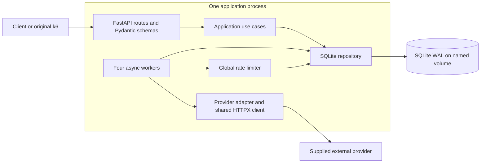
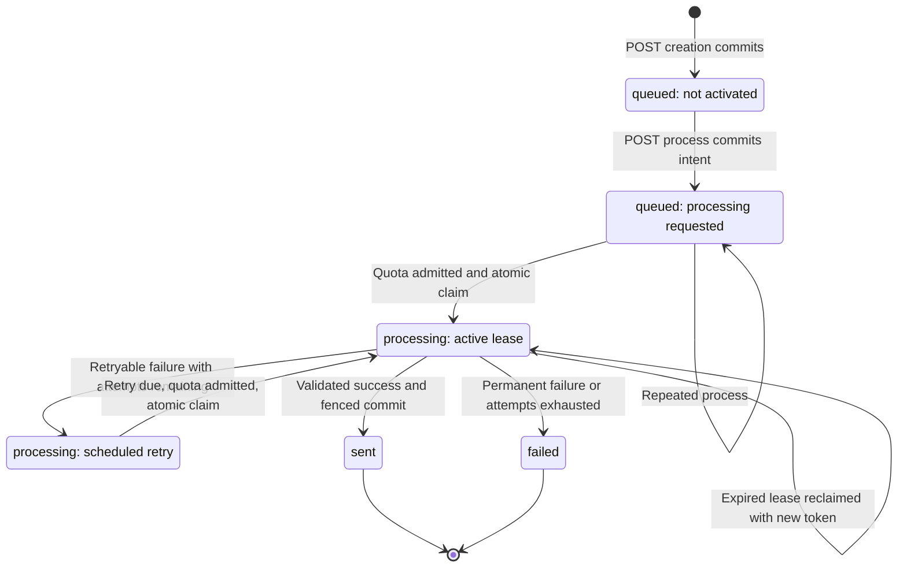
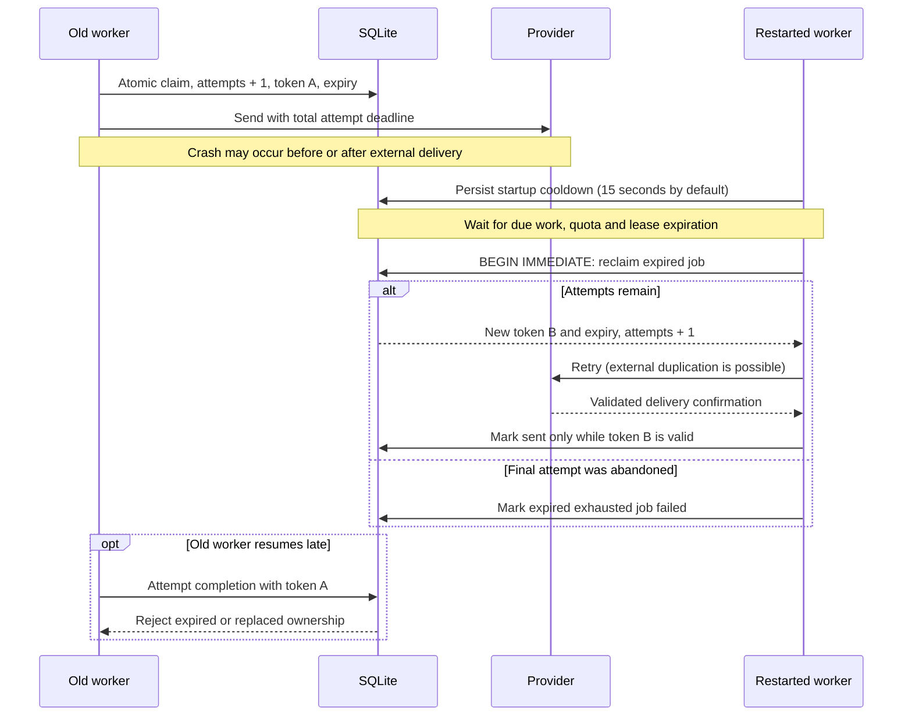
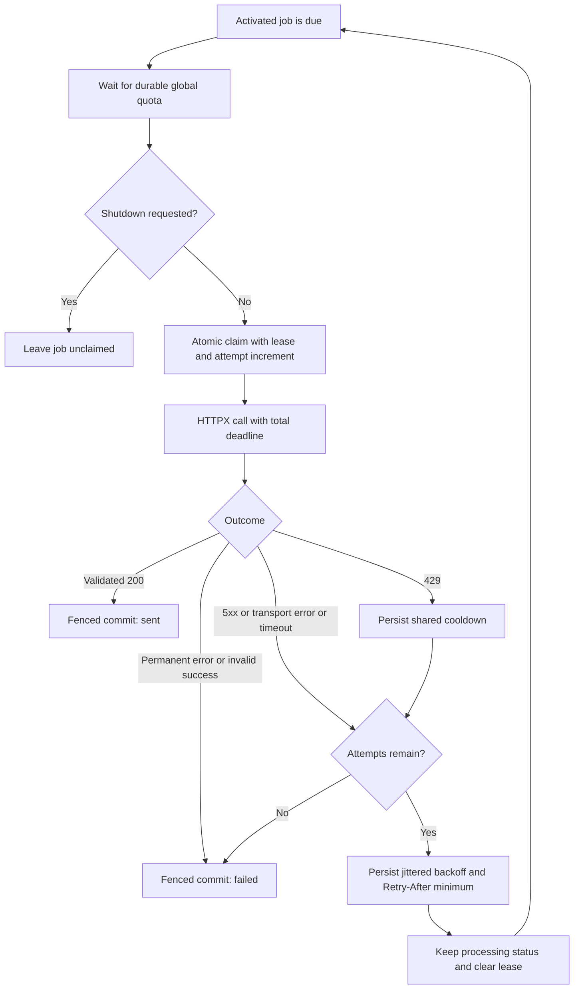

# Architecture and operational decisions

## Scope and contracts

The service runs on Python 3.12 and preserves the [HTTP contracts](../readme.md#http-api)
on port 5000. Successful creation and activation responses follow the SQLite
commit. Readiness indicates storage and worker task availability, not immediate
provider availability or an empty backlog.

Creation does not send. `process_requested_at` records the separate dispatch
intent; this is necessary because both registered and dispatchable jobs can be
publicly `queued`. Identical creation payloads intentionally produce different
IDs. Optional creation idempotency is deferred.

## Components and boundaries

The architecture uses modules rather than a large hierarchy of packages:

- `domain.py`: immutable notification and channel/status enums.
- `service.py`: creation, activation and retrieval use cases, with a small
  repository protocol independent of FastAPI and SQLite.
- `api.py`: Pydantic v2 HTTP schemas and routes.
- `repository.py`: transactions, durable queue, leases and shared quota storage.
- `provider.py`: provider port and asynchronous HTTPX adapter.
- `worker.py`: bounded orchestration and retry policy.
- `rate_limiter.py`: durable sliding-window admission and global cooldown.
- `main.py`: application composition, shared client and lifespan shutdown.

The queue is the notifications table. There is no database/broker dual write and
no unbounded collection of per-request tasks. Four worker tasks share one HTTPX
client, with a connection pool limited to the worker count. SQLite is accessed
through aiosqlite; a connection-local lock prevents interleaved transactions.
`BEGIN IMMEDIATE` provides atomicity across additional connections/processes.
No database transaction spans an HTTP call or a quota/backoff wait.

## Request lifecycle

`Registered` and `Ready` are explanatory substates, not additional stored status
values. Repeated process calls do not reset retry schedules or reopen terminal
states. The self-transition on `Active` requires the old lease to have expired.

## Worker recovery

The public lifecycle is `queued -> processing -> sent|failed`. A transient failure
remains `processing` with a durable `next_attempt_at`, but no live lease. Terminal
states are immutable through the public API.

Each claim atomically increments the attempt count and writes a fresh random
lease token and expiration. Claims only select activated, due jobs without an
unexpired lease. Completion requires the matching token and an unexpired lease.
A late worker cannot overwrite a replacement worker's result.

The default lease is 30 seconds. The total provider attempt deadline is 5 seconds;
configuration requires the lease to exceed it by more than two seconds for local
storage operations. No heartbeat machinery is needed for these bounded attempts.
Workers acquire provider quota **before** claiming a job, so a rate-limit wait
cannot consume a lease. Shutdown stops the loop, waits up to six seconds, then
cancels outstanding tasks; abandoned leases remain recoverable. Workers waiting
for quota check the stop signal before claiming new work.

Every worker pass can reclaim expired leases. If a process dies during its final
allowed attempt, the expired record is atomically marked failed rather than left
in processing forever. Recovery needs a running worker and available storage;
there is no claim that jobs progress while the entire service is down.
Scheduled attempts are ordered by eligibility time, preventing new arrivals from
indefinitely jumping ahead of older retries.

## Delivery guarantee

**Exactly-once delivery is impossible with the supplied provider contract.**
The provider has neither an idempotency key nor a delivery lookup endpoint.
It can deliver a notification and lose the response; the application can also
crash between receiving success and committing `sent`. Retrying either case can
deliver twice. Durable leases prevent concurrent ownership and stale writes,
but cannot make an external side effect transactional with SQLite.

The service makes bounded delivery attempts and only records `sent` after a
validated provider response (`200`, `status=delivered`, nonempty provider ID).
Timeout retries favor eventual delivery with a documented duplicate risk.
`failed` means the service cannot confirm delivery, not proof that the recipient
received nothing. Invalid 200 bodies fail permanently to avoid blindly resending
an already accepted operation. Provider IDs are not unique local identifiers.

## Provider quota and failures

The original provider admits 50 attempts per sliding 10-second window, including
attempts that later fail with 500, and has a separate 50-request semaphore.
Latency is uniformly simulated between 100 and 500 ms; admitted attempts have a
10% random failure probability. A semaphore alone cannot enforce this quota.

All workers use an atomic SQLite-backed sliding-window limiter. Permits and
cooldown deadlines survive reopening the database and are shared across
connections. Old permits expire after the window plus a 1 ms boundary margin.
An additional default spacing of 1/4.5 seconds smooths traffic. Every startup
extends the shared cooldown by one window plus the total attempt deadline
(15 seconds by default), conservatively covering old in-flight requests.
Canceled or unused permits count conservatively until they expire.

Quota is enforced at client dispatch; unexpected network delay, other clients
sharing the provider, or clock changes can still cause provider-side 429s.
Those responses remain real failures, triggering a shared cooldown. Settings
must match the actual provider quota; increasing the configured limit does not
increase provider capacity. Deployment is one Uvicorn process on one host; this
is not a distributed clock or multi-host SQLite design.

429 and 5xx responses and transport failures are retryable. Other HTTP statuses,
including authentication errors and redirects, fail permanently. Up to five
total attempts are allowed; abandoned leases also consume attempts. Full jitter
uses `uniform(0, min(30, 1 * 2**(attempt-1)))` seconds. Valid `Retry-After` delta or
HTTP-date headers are respected. Without it, a 429 pauses admission for at least
the configured provider window. Retry schedules are persisted, not sleeping jobs.
The shared client additionally has connect/write/pool timeouts of one second and
a read timeout of two seconds, within the five-second total attempt deadline.

### Retry decisions

The claim can also find no available job after another worker wins. All completion
writes require a current token and unexpired lease; a failed fenced write does not
change status. Unexpected exceptions/cancellation leave the lease for recovery.

## Persistence, capacity and deployment

SQLite uses WAL, `synchronous=FULL`, short transactions and a one-second busy
timeout. Local durable storage is adequate for this one-instance challenge;
fsync cost and SQLite's single-writer throughput remain measurable constraints.
A separate broker would add deployment and acknowledgement/transaction complexity
without increasing the supplied provider's throughput. Internal workers keep the
challenge small, but share the API process's failure and resource boundaries; the
durable table, rather than task memory, is what makes restarts recoverable.
The named `/data` volume survives container replacement. Removing that volume
deletes notifications. WAL is intended for local storage, not shared NFS.

The configurable capacity defaults to 10,000 nonterminal requests, including
registered requests that have not been activated. The supplied test can produce
at most roughly `200 / 1.5 * 40 = 5,334` arrivals during its staged interval when
HTTP latency is negligible (plus graceful iteration completion). Its actual ramp
produces fewer. 10,000 provides substantial headroom for that test and a backlog
from a previous run; it is not an unlimited queue or a promise to absorb sustained
overload. Existing accepted jobs continue when new creation is rejected.

At 4.5 attempts/s and 10% transient failures, expected delivery capacity is about
4.05 notifications/s. Thousands of accepted notifications take minutes to drain.
HTTP acceptance latency must be evaluated separately from end-to-end delivery.
Backlog capacity is a count limit, not a byte/disk limit. Payload byte limits,
creation idempotency, automatic retention, detailed metrics and distributed
infrastructure are deliberately deferred. Unactivated requests consume capacity
until managed explicitly. Terminal records are retained in this implementation;
monitor disk usage and back up data before manual maintenance.

Compose preserves the original shared network namespace: the app reaches
`127.0.0.1:3001`, and k6 reaches `provider:5000`. The app runs as UID 10001.
Configuration is loaded from `NOTIFY_*` environment variables; the public test
credential is supplied by Compose, not embedded in application code. Startup
fails if workers are enabled without a provider key. See `.env.example`.

Dependencies remain the supplied FastAPI/Uvicorn/Pydantic/HTTPX pins plus
aiosqlite. Tenacity is removed because retry scheduling must survive crashes.
Pytest, pytest-asyncio and Ruff are development-only dependencies.

## Observability and known environment limitations

Application events use JSON with request ID, attempt, failure category and whether
the state write succeeded. Payloads, recipients and API keys are not logged by
the app. The original provider does log recipients. Worker exceptions are logged
and retried through lease recovery rather than silently dropping work.

The supplied Grafana dashboard measures client-facing HTTP behavior, not provider
delivery. Its URL grouping includes request IDs and can increase InfluxDB series
cardinality. Its background-overhead label does not measure internal HTTP calls.
Grafana's anonymous admin configuration, the public provider key, HTTP without
TLS, unprotected application endpoints and old supplied dependency pins are for
this local assessment, not a public production deployment. Dependency upgrades
and production authentication are separate changes requiring compatibility work.
